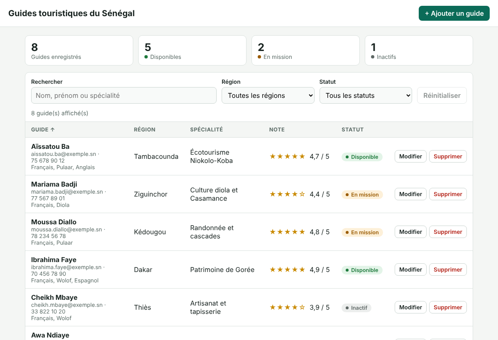
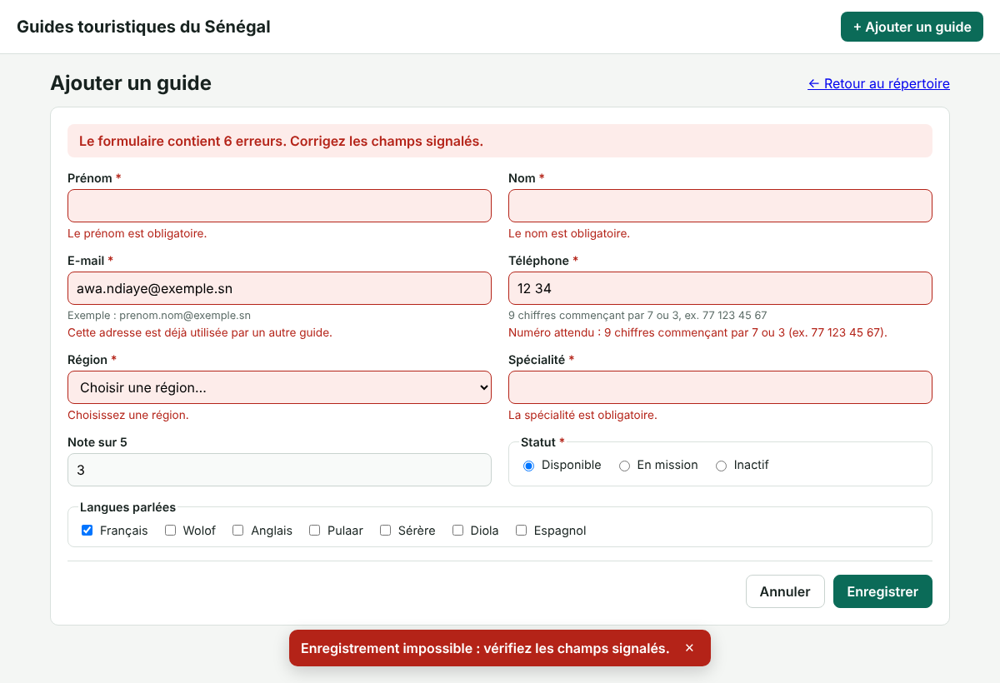
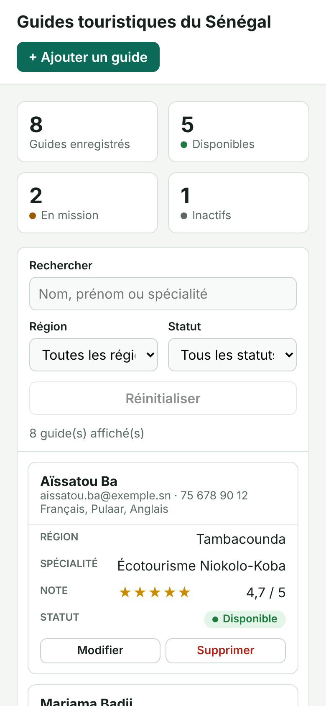

# Guides touristiques du Sénégal

Application Angular de gestion d'un répertoire de guides touristiques au Sénégal.
Un agent de la structure de promotion du tourisme peut **consulter, rechercher, filtrer, ajouter, modifier et supprimer** des fiches de guides.
Projet réalisé dans le cadre de l'évaluation finale Angular. **Toutes les données sont fictives.**

**Démo en ligne :** https://bmgraphie.github.io/guide-touristique/



---

## Fonctionnalités

- **Répertoire** des guides sous forme de tableau, qui devient une liste de cartes sur mobile
- **Indicateurs** : nombre total de guides, disponibles, en mission, inactifs
- **Recherche** par nom, prénom ou spécialité, sans tenir compte des accents ni des majuscules
- **Filtres** par région et par statut, combinables avec la recherche
- **Tri** par nom ou par note, en cliquant sur l'en-tête de colonne
- **Note formatée par un pipe** : `4.6` s'affiche « ★★★★★ 4,6 / 5 »
- **Badges de statut** colorés (Disponible, En mission, Inactif), avec le texte toujours écrit
- **Ajout et modification** dans un même formulaire, pré-rempli en mode modification
- **Validations** : champs obligatoires, longueurs minimales, format de l'e-mail et du téléphone, e-mail unique
- **Suppression avec confirmation** dans une boîte de dialogue
- **Messages de succès et d'erreur** après chaque action
- **États vides** : « Aucun guide pour l'instant » et « Aucun guide ne correspond »
- **Accessibilité** : un label par champ, navigation complète au clavier, lien d'évitement, messages lus par les lecteurs d'écran

| Formulaire avec erreurs de validation | Affichage mobile |
| --- | --- |
|  |  |

---

## Prérequis

| Outil | Version utilisée | Vérifier avec |
| --- | --- | --- |
| Node.js | 22 LTS ou 24 LTS | `node --version` |
| npm | fourni avec Node.js | `npm --version` |
| Angular CLI | 22.3 | `ng version` |
| Git | 2.x | `git --version` |

Installer Angular CLI : `npm install -g @angular/cli`

## Installation

```bash
git clone https://github.com/Bmgraphie/guide-touristique.git
cd guide-touristique
npm install
```

## Lancement

```bash
ng serve --open
```

L'application s'ouvre sur http://localhost:4200 et se recharge à chaque modification du code.

## Tests et compilation

```bash
ng test --watch=false   # 19 tests unitaires (Vitest)
ng build                # version de production dans dist/guide-touristique/browser
```

---

## Structure du projet

```
src/app/
├── models/guide-touristique.ts         # Interface GuideTouristique, types Region et StatutGuide
├── data/guides-demo.ts                 # 8 guides fictifs de démonstration
├── services/
│   ├── guide-touristique.service.ts    # Données et méthodes CRUD (ajouter, modifier, supprimer…)
│   └── notification.service.ts         # Messages de succès et d'erreur
├── validators/guide.validators.ts      # Formats e-mail et téléphone, validateur « e-mail unique »
├── pipes/note.pipe.ts                  # Formatage de la note (4.6 → « 4,6 / 5 » ou étoiles)
├── components/
│   ├── guide-list/                     # Répertoire : recherche, filtres, tri, suppression
│   └── guide-form/                     # Formulaire d'ajout et de modification
├── app.routes.ts                       # Routes de l'application
├── app.ts / app.html / app.css         # Composant racine : en-tête, zone des pages, messages
└── app.config.ts                       # Configuration (routeur)
```

**Rôle des fichiers générés par Angular CLI**

| Fichier | Rôle |
| --- | --- |
| `src/main.ts` | Point d'entrée : démarre l'application avec le composant racine `App` |
| `src/index.html` | Page HTML unique qui accueille l'application (`<app-root>`) |
| `src/styles.css` | Styles globaux, partagés par toute l'application |
| `angular.json` | Configuration du CLI : compilation, serveur de développement, tests |
| `package.json` | Dépendances du projet et scripts npm |
| `tsconfig.json` | Options du compilateur TypeScript |

## Architecture

Les responsabilités sont séparées :

- Les **composants** affichent les données et réagissent aux actions de l'utilisateur.
- Le **service** `GuideTouristiqueService` est le **seul** endroit qui détient et modifie les guides. Il est injectable (`@Injectable({ providedIn: 'root' })`) et partagé par toute l'application.
- Les deux composants ne communiquent **jamais directement** : ils passent toujours par le service.
- Le **pipe** `note` s'occupe uniquement du formatage de la note.

| URL | Composant | Écran |
| --- | --- | --- |
| `/guides` | `GuideList` | Répertoire, recherche, filtres, suppression |
| `/guides/nouveau` | `GuideForm` | Ajout d'un guide |
| `/guides/:id/modifier` | `GuideForm` | Modification (formulaire pré-rempli) |
| `/` et toute URL inconnue | redirection | vers `/guides` |

**Notions Angular utilisées :** composants autonomes (standalone), signaux (`signal`, `computed`), nouvelle syntaxe de contrôle (`@if`, `@for`, `@empty`), Reactive Forms, `[(ngModel)]`, injection de dépendances avec `inject()`, routage avec paramètres, pipe personnalisé, validateur personnalisé.

## Règles de validation du formulaire

| Champ | Règles |
| --- | --- |
| Prénom, Nom | obligatoires, 2 caractères minimum |
| E-mail | obligatoire, format valide (ex. `nom@exemple.sn`), non utilisé par un autre guide |
| Téléphone | obligatoire, 9 chiffres commençant par 7 ou 3 (ex. `77 123 45 67`), `+221` accepté |
| Région | obligatoire, choisie dans la liste des 14 régions |
| Spécialité | obligatoire, 3 caractères minimum |
| Note | entre 0 et 5 |
| Statut | obligatoire |

---

## Limites de la solution

1. **Données en mémoire** : les guides sont stockés dans le service. Toute modification est perdue au rechargement de la page.
2. **Pas d'authentification** : n'importe quel utilisateur peut ajouter, modifier ou supprimer une fiche.
3. **Validation côté client uniquement** : dans une vraie application, le serveur devrait refaire les mêmes contrôles, car ceux du navigateur peuvent être contournés.
4. **Identifiants générés localement** (le plus grand id + 1) : risque de doublons si plusieurs agents travaillaient en même temps.
5. **Pas de pagination** : l'affichage ralentirait avec plusieurs milliers de guides.

## Évolution vers une API REST

Grâce à la séparation des responsabilités, **seul le service change** : les composants restent identiques.

1. Ajouter `provideHttpClient()` dans `app.config.ts`.
2. Remplacer, dans `GuideTouristiqueService`, la liste en mémoire par des appels HTTP :

| Méthode du service | Appel HTTP |
| --- | --- |
| liste des guides | `GET /api/guides` |
| `getById(id)` | `GET /api/guides/:id` |
| `ajouter(guide)` | `POST /api/guides` |
| `modifier(guide)` | `PUT /api/guides/:id` |
| `supprimer(id)` | `DELETE /api/guides/:id` |

```typescript
private readonly http = inject(HttpClient);
private readonly url = '/api/guides';

ajouter(data: NouveauGuide) {
  return this.http.post<GuideTouristique>(this.url, data);
}
```

3. Afficher un **indicateur de chargement** pendant les appels et un **message d'erreur clair** si le serveur ne répond pas.
4. Le serveur attribue les identifiants et vérifie les données, ce qui règle les limites 1, 3 et 4.

---

## Travail en équipe

Le projet a été réalisé à trois avec Git et GitHub. Chaque membre a travaillé sur sa propre branche, puis les branches ont été fusionnées dans `main` par des pull requests relues par un autre membre.

| Membre | Branche | Partie |
| --- | --- | --- |
| *Baye Matar Thiam* | `main` | Création du projet, modèle, données de démo, service, routes |
| Makhtar Sarr | `feature/liste` | Répertoire, recherche, filtres, tri, pipe, suppression |
| *Aminata Diene* | `feature/formulaire` | Formulaire, validations, messages de succès et d'erreur |
| *Baye Matar Thiam* | `feature/qualite` | Accessibilité, responsive, README, captures, mise en ligne |

## Ressources utilisées

- [Angular](https://angular.dev) 22.3 et Angular CLI, documentation officielle
- [TypeScript](https://www.typescriptlang.org)
- [Vitest](https://vitest.dev), lanceur de tests intégré à Angular
- [angular-cli-ghpages](https://www.npmjs.com/package/angular-cli-ghpages), pour la mise en ligne sur GitHub Pages
- Guide pratique « pas à pas » Angular fourni par l'enseignant
- Aucune bibliothèque d'interface externe : tous les styles sont écrits en CSS
- Données : personnes, e-mails et numéros **entièrement fictifs**
